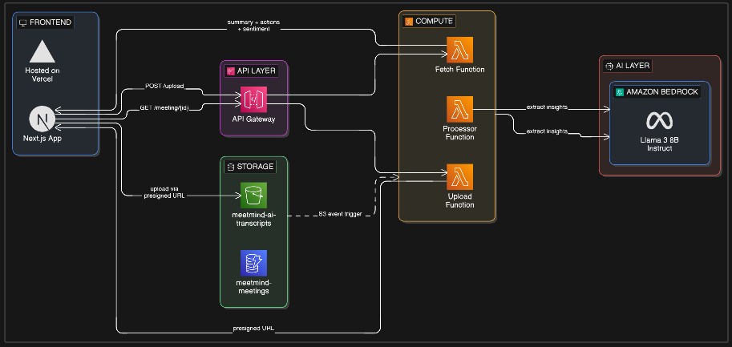

# MeetMind AI

Turn long meetings into clear decisions.
MeetMind AI is an AI-powered meeting intelligence platform that transforms raw meeting transcripts into:

- 📄 Structured summaries

- ✅ Action items

- 😊 Sentiment analysis

- 📊 Strategic insights

- 🌐 Live Demo:
  - 👉 https://meetmind-ai-two.vercel.app/

# What It Does

Upload a .txt meeting transcript and MeetMind AI will:
- Extract executive-level summary
- Identify key action items
- Analyze team sentiment
- Structure the output into clean JSON
- Display results in a modern UI
- All powered by Amazon Bedrock (Llama 3) and serverless AWS infrastructure.

# Architecture Overview


# Tech Stack
- Frontend
    - Next.js (App Router)
    - TypeScript
    - TailwindCSS
    - Framer Motion
    - shadcn/ui
    - Deployed on Vercel

- Backend (AWS)
    - API Gateway (HTTP API)
    - AWS Lambda
    - Amazon S3 (presigned uploads)
    - Amazon DynamoDB
    - Amazon Bedrock (Meta Llama 3 8B Instruct)
    - IAM (fine-grained roles)
    - CloudWatch logging
    - Terraform (Infrastructure as Code)

# How It Works
- Upload Phase
    - Frontend calls POST /upload
    - Lambda generates:
        - meetingId
        - Presigned S3 upload URL
    - Frontend uploads transcript directly to S3

- Processing Phase
    - S3 triggers Processor Lambda
    - Lambda:
        - Reads transcript
        - Calls Amazon Bedrock (Llama 3)
        - Extracts structured JSON
        - Stores results in DynamoDB

- Retrieval Phase
    - Frontend polls /meeting/{meetingId}
    - When status = COMPLETED, UI renders:
        - Summary
        - Action items
        - Sentiment

# Local Development

 Frontend
 ``` bash
cd frontend
npm install
npm run dev
```
Create .env.local:
```bash
NEXT_PUBLIC_API_BASE=https://your-api-id.execute-api.ap-south-1.amazonaws.com
```
Backend (Terraform)
```bash
cd infra/terraform
terraform init
terraform apply
```

# Tests and Benchmark

There is no automated unit-test suite in the repository. The standalone processor
benchmark sends 20 short, medium, and long transcripts, including disfluent speech,
through the summarization handler and checks the exact `summary`, `actionItems`,
and `sentiment` JSON schema.

Run with mocked AWS services (does not require AWS credentials):
```bash
python benchmarks/benchmark_processor.py
```

Run end-to-end against a deployed stack with Bedrock access:
```bash
python benchmarks/benchmark_processor.py --live \
  --api-url https://<api-id>.execute-api.<region>.amazonaws.com
```

On 2026-10-16, the mocked run produced 19/20 schema-valid responses (95%), with
one fallback and no handler failures. The live AWS run produced 18/20 schema-valid
responses (90%), with two fallbacks, no retries, and no handler failures. These
are results from one 20-transcript run, not a guarantee of model quality; fallback
sentiment is `Unknown`, which is outside the declared sentiment schema.

# Security
- Presigned S3 uploads (no direct credentials exposed)
- IAM least-privilege roles
- Bedrock access scoped via Lambda role
- CORS restricted to frontend domains
- DynamoDB partitioned by meetingId

# Deployment
- Frontend

  - Deployed on Vercel:
  - https://meetmind-ai-two.vercel.app/

- Backend
Provisioned using Terraform:
  - API Gateway
  - Lambda
  - S3
  - DynamoDB
  - IAM

# Future Improvements
- User authentication (Cognito / Auth.js)
- Meeting history dashboard
- Export to PDF
- Slack integration
- Calendar integration
- Chunked transcript processing
- Executive insights + theme tagging
- Custom domain

# Why This Matters
MeetMind AI demonstrates:
- Real-world async AI processing
- Production serverless architecture
- Bedrock LLM integration
- Full-stack TypeScript application
- Infrastructure as Code with Terraform

# Author
Built by Aaditya Saxena

AI • Cloud • Full-Stack Engineering